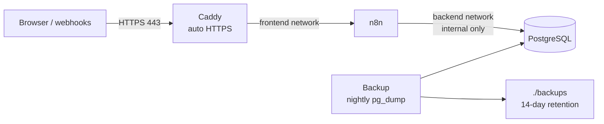

# Self-hosted n8n — production-ready stack

Run [n8n](https://n8n.io) on your own server with automatic HTTPS, a real database and nightly backups. One command to start, one command to update.



## What you get

| Feature | How |
|---|---|
| **Automatic HTTPS** | Caddy requests and renews Let's Encrypt certificates |
| **Production database** | PostgreSQL instead of the default SQLite |
| **Nightly backups** | `pg_dump` at 03:00, compressed, kept for 14 days |
| **Isolated database** | PostgreSQL sits on an internal-only network, no published ports |
| **n8n not exposed directly** | Only Caddy publishes ports; n8n is reachable through it |
| **Safe updates** | `scripts/update.sh` backs up before pulling new images |
| **One-step restore** | `scripts/restore.sh <backup>` |
| **Tidy history** | Execution logs older than 14 days are pruned automatically |
| **Privacy** | n8n telemetry disabled |

## Requirements

- A Linux server with Docker and Docker Compose (any €5/month VPS works: Hetzner, DigitalOcean, OVH, Contabo), or a home server
- For public HTTPS: a domain with an **A record** pointing to the server, and ports **80 and 443** open
- 1 vCPU and 1–2 GB RAM is enough to start

## Quick start

```bash
git clone <this-repo> n8n-stack && cd n8n-stack
cp .env.example .env
```

Fill in `.env`:

```bash
# generate secrets
openssl rand -hex 32   # -> N8N_ENCRYPTION_KEY
openssl rand -hex 24   # -> POSTGRES_PASSWORD
```

Set `N8N_DOMAIN` to your domain, then:

```bash
docker compose up -d
docker compose logs -f caddy n8n
```

Open `https://<your-domain>` and create the owner account.

> **Store `N8N_ENCRYPTION_KEY` somewhere safe** (password manager). Without it, the credentials inside a backup cannot be decrypted.

## Test it locally first

Set `N8N_DOMAIN=localhost` in `.env` and run `docker compose up -d`. Caddy then uses its own local certificate authority, so your browser will show a certificate warning — that is expected for a local test. Open `https://localhost`.

## Running on Unraid or another home server

Home servers often use ports 80/443 already (for the web UI or another reverse proxy). Two options:

1. **Different ports:** set `HTTP_PORT=8088`, `HTTPS_PORT=8443` and `N8N_PUBLIC_URL=https://<server>:8443/` in `.env`, and reach n8n via that URL on the LAN or through Tailscale. With an IP address as `N8N_DOMAIN`, Caddy uses its own local certificate, so expect a browser warning.
2. **Existing reverse proxy:** remove the `caddy` service, add n8n to your proxy's network, and point the proxy at `n8n:5678`.

On Unraid, put the folder under `/mnt/user/appdata/n8n-stack` and run it with the Compose Manager plugin. Include `backups/` in your Appdata Backup job.

Do not expose a home server to the internet just for webhooks — use a VPS for that, or a tunnel you control.

## Backups

- Automatic: every night at 03:00 (`BACKUP_CRON`), kept for `BACKUP_KEEP_DAYS` days, written to `./backups/`.
- Manual backup now:

  ```bash
  docker compose exec backup /bin/sh /usr/local/bin/backup.sh
  ```

- Restore:

  ```bash
  sh scripts/restore.sh backups/n8n_2026-11-05_0300.sql.gz
  ```

- Copy `./backups/` off the server (another machine, object storage). A backup on the same disk is not a backup.

## Updating

```bash
sh scripts/update.sh
```

It backs up the database, pulls new images, restarts and cleans old images. For production, pin `N8N_VERSION` in `.env` to a specific release and read the n8n release notes before changing it.

## Monitoring

n8n exposes a health endpoint at `https://<your-domain>/healthz`. Add it to any uptime monitor:

- **Uptime Kuma:** HTTP(s) monitor on `/healthz`, expect status 200
- **Checkmk:** "Check HTTP web service" rule on the same URL, plus a certificate-expiry check

## Security checklist

- [ ] `.env` is not committed (it is in `.gitignore`)
- [ ] Strong, unique `POSTGRES_PASSWORD` and `N8N_ENCRYPTION_KEY`
- [ ] Server firewall allows only 22, 80 and 443
- [ ] SSH with keys only, password login disabled
- [ ] Owner account uses a strong password and 2FA
- [ ] Backups copied off the server and a restore has been tested once

## File layout

```
.
├── docker-compose.yml   # n8n, postgres, caddy, backup
├── .env.example         # copy to .env
├── caddy/Caddyfile      # reverse proxy + security headers
├── backup/backup.sh     # nightly pg_dump with retention
├── scripts/update.sh    # backup -> pull -> restart
├── scripts/restore.sh   # restore a backup
├── backups/             # created on first backup (ignored by git)
└── shared/              # mounted in n8n at /files for file workflows
```

---

## Demo: AI invoice extractor

The [`demo/`](demo/) folder contains a ready-to-import n8n workflow that reads PDF invoices with AI, checks totals, Belgian VAT numbers and IBANs with code, and stores the result in PostgreSQL — flagging anything that doesn't add up.

## License

MIT — see [LICENSE](LICENSE).

---

Need this set up on your server, or an automation built on top of it? Open an issue or contact [@tibo00](https://github.com/tibo00).
