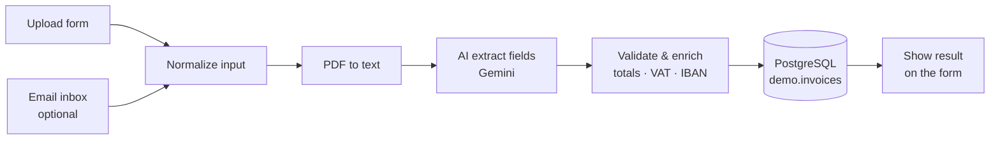

# Demo: AI invoice extractor

Upload a PDF invoice (or email it) and AI turns it into clean, checked data in a database — no more typing invoices over by hand.



## What it does

1. **Input:** a web form for uploading a PDF, or (optional) an IMAP inbox that picks up emailed invoices.
2. **Read:** extracts the text from the PDF.
3. **Understand:** an AI model (Google Gemini by default; Claude, OpenAI or a local Ollama model also work) pulls out supplier, VAT number, invoice number, dates, net/VAT/total amounts and IBAN — in Dutch, French or English.
4. **Check:** code — not AI — verifies the result:
   - net + VAT equals the total (within 2 cents)
   - Belgian VAT number checksum (mod 97)
   - IBAN checksum (mod 97)
   - dates are present and the due date is not before the invoice date
5. **Save:** writes one row per invoice to PostgreSQL, with a `needs_review` flag and the reasons.
6. **Answer:** the form shows "Invoice saved" or "Saved — needs review" with what's wrong.

The AI never gets the final word: anything that doesn't add up is flagged for a human.

## Files

| File | Purpose |
|---|---|
| `ai-invoice-extractor.json` | The n8n workflow (import it) |
| `invoices.sql` | Creates the `demo.invoices` table |
| `sample-invoice-ok.pdf` | Fictitious invoice that passes all checks |
| `sample-invoice-needs-review.pdf` | Fictitious invoice whose total doesn't match — gets flagged |

## Install (on the n8n stack)

The stack mounts `shared/` into n8n at `/files`, so put this folder at `shared/demo/`.

1. **Create the table**

   ```bash
   cd /mnt/user/appdata/n8n-stack
   docker compose exec -T postgres psql -U n8n -d n8n < shared/demo/invoices.sql
   ```

2. **Import the workflow**

   ```bash
   docker compose exec n8n n8n import:workflow --input=/files/demo/ai-invoice-extractor.json
   ```

   Or in the n8n editor: **Create workflow → ⋯ → Import from file**.

3. **Add two credentials** (open the workflow; the nodes with a warning need them):
   - **Gemini** node → *Google Gemini (PaLM) API* credential with a free API key from aistudio.google.com. The free tier is rate-limited and Google may use free-tier data to improve its models, so use it for demos, not real client invoices — swap in a paid or local model for production.
   - **Save to database** node → *Postgres* credential: host `postgres`, database `n8n`, user `n8n`, password = `POSTGRES_PASSWORD` from `.env`, port `5432`, SSL disabled.

4. **Test:** click **Test workflow**, upload `sample-invoice-ok.pdf` in the form that opens, then `sample-invoice-needs-review.pdf`.

5. **Check the data:**

   ```bash
   docker compose exec postgres psql -U n8n -d n8n -c \
     "select id, supplier_name, invoice_number, total_amount, needs_review, review_reasons from demo.invoices order by id desc limit 5;"
   ```

6. **Go live:** activate the workflow and use the production form URL shown in the **Upload form** node.

## Optional: process emailed invoices

Enable the **Email inbox** node, add an IMAP credential (use an app password, and a dedicated mailbox), and activate the workflow. It reads unread mails, takes the first PDF attachment and runs the same pipeline.

## Adapting it for a client

- Swap PostgreSQL for **Google Sheets**, **Airtable** or an accounting tool (e.g. via API).
- Add a **Telegram/Slack** message for invoices that need review.
- Add an approval step before payment.
- Costs: one invoice is a few thousand tokens — fractions of a cent with a small model.

All sample data is fictitious.
