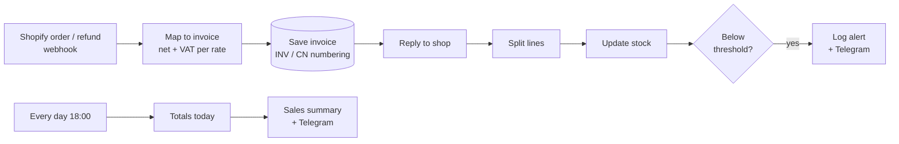

# Demo: webshop orders → accounting

Every webshop **order** becomes a numbered **invoice**, every **refund** a **credit note** — with net and VAT per rate, totals checked against the shop, stock updated, low-stock alerts, and a daily sales summary. Built for Belgian/EU shops (prices incl. VAT, 6% and 21% rates).



## What it does

- **Orders → invoices.** Reads Shopify's order format (prices including VAT), calculates net and VAT per line and per rate, and stores the invoice with gap-free numbering (`INV2026-00001`).
- **Refunds → credit notes.** A separate numbering series (`CN2026-00001`) with negative amounts, and the stock is put back.
- **Checks, not trust.** Line totals must match the shop's total and VAT; unusual Belgian VAT rates are flagged. Anything off is saved with `needs_review` and the reason.
- **Exactly once.** Shopify retries webhooks; the same order or refund is only booked once (database constraint), and the retry gets `"duplicate": true`.
- **Stock and alerts.** Stock is updated per product; below the threshold an alert is logged (and sent to Telegram when enabled).
- **Daily summary** at 18:00: orders, refunds, revenue incl./excl. VAT, VAT, items to review, alerts.
- **Secured webhooks.** Requests without the `X-Shop-Token` header are rejected (403).

## Tested result

Sent to the live workflow with `send-test-orders.sh` (fictitious coffee shop):

| Sample | Result |
|---|---|
| Order #1001 — 2× coffee (6%), 1× mug (21%), shipping | `INV2026-00001`, €44.90 (net 40.03 + VAT 4.87: 6% 1.42, 21% 3.45) |
| Order #1002 — grinder + coffee | `INV2026-00002`, €61.50 · grinder stock 3 → 2 → **low-stock alert** |
| Order #1003 — shop total doesn't match lines | `INV2026-00003` saved, **needs review**: *line total 49.80 differs from shop total 47.80* |
| Refund of the mug from #1001 | `CN2026-00001`, −€14.95, mug back in stock |
| Order #1001 sent again (Shopify retry) | `{"duplicate": true}` — no second invoice, stock unchanged |
| Request without token | HTTP 403 |
| Daily summary | 3 orders, 1 refund, €141.25 incl. VAT (€121.12 excl., VAT €20.13), 1 to review, 1 low-stock alert |

## Files

| File | Purpose |
|---|---|
| `webshop.sql` | Tables, numbering and demo product catalogue |
| `webshop-orders-to-accounting.json` | Workflow: order/refund → invoice/credit note, stock, alerts |
| `webshop-daily-summary.json` | Workflow: daily summary (schedule + on-demand webhook) |
| `map-order.js` | The order → invoice logic (readable source, embedded by `build.mjs`) |
| `build.mjs` | Regenerates both workflow JSON files: `node build.mjs` |
| `samples/` | Shopify-format test orders and a refund |
| `send-test-orders.sh` | Sends all samples plus a duplicate, then fetches the summary |

## Install (on the n8n stack)

1. Copy this folder to `shared/demo/webshop/` and create the tables:

   ```bash
   cd /mnt/user/appdata/n8n-stack
   docker compose exec -T postgres psql -U n8n -d n8n < shared/demo/webshop/webshop.sql
   ```

2. Import both workflows (editor: **⋯ → Import from file**, or CLI):

   ```bash
   docker compose exec n8n n8n import:workflow --input=/files/demo/webshop/webshop-orders-to-accounting.json
   docker compose exec n8n n8n import:workflow --input=/files/demo/webshop/webshop-daily-summary.json
   ```

3. Credentials:
   - **Postgres** on every database node (host `postgres`, database/user `n8n`, password from `.env`).
   - **Header Auth** on both webhook nodes: name `X-Shop-Token`, value = a long random string (`openssl rand -hex 24`).

4. Activate both workflows and test:

   ```bash
   N8N_URL=https://your-n8n SHOP_TOKEN=your-token sh send-test-orders.sh
   ```

## Connecting a real Shopify store

1. Create a free **Shopify Partner** account and a **development store**; add products with SKUs matching `demo.products` (or load your own catalogue into that table).
2. **n8n publicly reachable (VPS):** in Shopify admin → Settings → Notifications → Webhooks, add `orders/create` and `refunds/create` pointing to `https://your-n8n/webhook/shop-orders`, *or* enable the **Shopify trigger** node with a custom-app access token (it registers webhooks and verifies Shopify's signature itself).
3. **n8n only on your LAN:** Shopify can't reach it — replace the trigger with a **Schedule** node that fetches new orders from the Shopify API every few minutes.

## Adapting it for a client

- Replace **Save invoice** with the client's accounting tool: Odoo (official n8n node), Exact, Yuki, Billit or Teamleader (via their APIs).
- Read stock from Shopify / bol.com instead of `demo.products`.
- Enable the **Telegram** nodes (bot token + chat ID) or swap them for email or Slack.
- Add the AI invoice extractor (`../`) for supplier invoices.

All shop names, customers and orders are fictitious.
